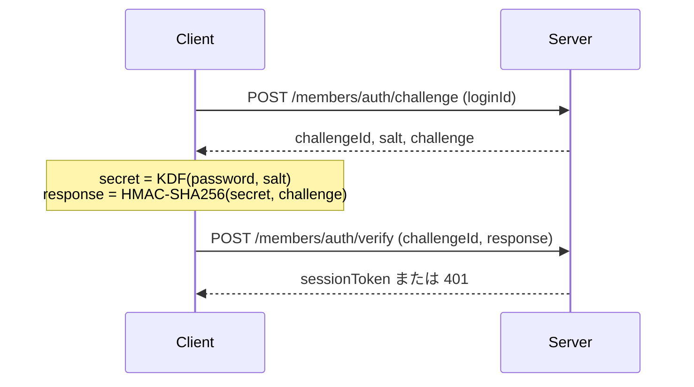
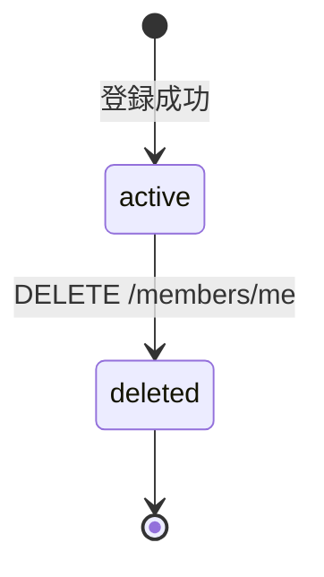

# 外部設計書: 会員

| 項目 | 値 |
| --- | --- |
| 文書ID | `EDS-MEM-1` |
| 機能 | `MEM`（会員） |
| 版 | `0.3` |
| 状態 | `approved` |
| 関連文書 | OpenAPI: `backend/openapi/openapi.yaml` / UT: `docs/ut/plans/UT-MEM-1`（未作成） / IT: `docs/it/plans/IT-MEM-1`（未作成） / アーキテクチャ: [go-architecture.md](../go-architecture.md) |

---

## 1. 目的・スコープ

### 目的

利用者が ID・パスワード・ニックネームだけで会員登録し、チャレンジレスポンスで認証し、退会（論理削除）できる最小の会員機能を提供する。

### In Scope

- 会員登録（ID / パスワード / ニックネーム）
- チャレンジレスポンス認証（挑戦発行 → 応答検証）
- 認証後セッションの発行（後続 API で会員を識別するため）
- 会員の論理削除（ID・パスワード検証情報・ニックネームのマスク、復元不可）

### Out of Scope

- パスワード再設定・メール確認・OAuth / 外部 IdP
- 管理画面・権限ロール
- リフレッシュトークン・セッション一覧・強制ログアウト UI
- レート制限・アカウントロックの本格実装（§10。初期は未実装とし、UT/IT・セキュリティ計画で追跡）
- フロントエンド画面の詳細 UI（API 契約を正とし、画面は後続）

---

## 2. 用語

| 用語 | 意味 |
| --- | --- |
| ログインID | 会員が認証に使う識別子。本設計の「ID」項目。永続上の主キーとは別に扱ってよい |
| 秘密値 | パスワードとソルトから KDF で導出した値。サーバは平文パスワードを保存しない |
| 挑戦（challenge） | サーバが発行する一度きりの乱数。応答計算の入力になる |
| 応答（response） | クライアントが秘密値と挑戦から計算する証明 |
| セッション | 認証成功後にサーバが発行する不透明なトークン。以降の要認証 API で提示する |
| 論理削除 | 行は残すが利用不可にし、個人識別に使う項目をマスクする |

---

## 3. アクター／前提

| アクター | 説明 |
| --- | --- |
| 未認証利用者 | 登録・挑戦要求・応答送信ができる |
| 認証済み会員 | 有効なセッションを持ち、自身の削除ができる |

### 前提

- 通信は TLS（本番）またはそれに準ずる保護下を想定する
- クライアントはソルト・挑戦・パスワードから応答を計算できる
- 文字数は Unicode のルーン数（Go の `[]rune` 長）で数える。ログインID・パスワードは ASCII 半角に限定するためバイト長と一致する

---

## 4. 機能一覧

| 機能ID | 名称 | 概要 |
| --- | --- | --- |
| F-01 | 会員登録 | ID・パスワード・ニックネームを受け取り、有効会員を作成する |
| F-02 | 挑戦発行 | ログインIDを受け取り、挑戦とソルトを返す（存在有無を漏らさない） |
| F-03 | 応答検証 | 挑戦IDと応答を検証し、成功時にセッションを返す |
| F-04 | 会員削除 | 認証済み会員を論理削除し、ID・秘密値・ニックネームをマスクする |

---

## 5. 画面／API 契約

パスは既存 API と同様、ホスト直下（例: `http://localhost:8080`）。JSON。文字コード UTF-8。

### 5.1 会員登録

| 項目 | 値 |
| --- | --- |
| 機能ID | F-01 |
| Method / Path | `POST /members` |
| 認証 | 不要 |

**リクエスト**

| 項目 | 型 | 必須 | 制約 |
| --- | --- | --- | --- |
| `loginId` | string | はい | §6 ログインID |
| `password` | string | はい | §6 パスワード |
| `nickname` | string | はい | §6 ニックネーム |

**レスポンス（成功）**

| 項目 | 型 | 説明 |
| --- | --- | --- |
| `loginId` | string | 登録したログインID |
| `nickname` | string | 登録したニックネーム |

パスワードおよび秘密値は返さない。

**ステータス**

| 状況 | HTTP | 本文の要点 |
| --- | --- | --- |
| 成功 | 201 | 上記 JSON |
| 入力不正 | 400 | **同一の汎用**（項目名の列挙・値のエコーはしない。制約は本 EDS / OpenAPI を正とする） |
| ログインIDまたはニックネームの重複 | 409 | **同一の汎用**（どちらが重複かは出さない。有効会員の列挙に使えないようにする） |

---

### 5.2 挑戦発行

| 項目 | 値 |
| --- | --- |
| 機能ID | F-02 |
| Method / Path | `POST /members/auth/challenge` |
| 認証 | 不要 |

**リクエスト**

| 項目 | 型 | 必須 | 制約 |
| --- | --- | --- | --- |
| `loginId` | string | はい | 形式チェックは登録時と同ルール。未登録でも同じ見た目の応答にする |

**レスポンス（成功）**

| 項目 | 型 | 説明 |
| --- | --- | --- |
| `challengeId` | string | この挑戦の識別子（応答時に返す） |
| `salt` | string | Base64。秘密値導出用（未登録時はダミーソルト） |
| `challenge` | string | Base64。一度きり有効な乱数 |

**ステータス**

| 状況 | HTTP | 本文の要点 |
| --- | --- | --- |
| 成功（登録有無を問わない） | 200 | 上記 JSON。未登録・削除済みでも 200 とダミー値 |
| 入力形式不正 | 400 | 汎用 |

未登録／削除済みでも **404 にしない**（ログインIDの有無を漏らさない）。

---

### 5.3 応答検証

| 項目 | 値 |
| --- | --- |
| 機能ID | F-03 |
| Method / Path | `POST /members/auth/verify` |
| 認証 | 不要（この API 自体が認証） |

**リクエスト**

| 項目 | 型 | 必須 | 制約 |
| --- | --- | --- | --- |
| `challengeId` | string | はい | 発行済みの挑戦 |
| `response` | string | はい | Base64。§7 の計算結果 |

**レスポンス（成功）**

| 項目 | 型 | 説明 |
| --- | --- | --- |
| `sessionToken` | string | 不透明なセッション（以降 `Authorization: Bearer <token>`） |
| `nickname` | string | 表示用ニックネーム |
| `expiresAt` | string | RFC3339。セッション有効期限 |

**ステータス**

| 状況 | HTTP | 本文の要点 |
| --- | --- | --- |
| 成功 | 200 | 上記 JSON |
| 入力不正・挑戦不明・期限切れ・応答不一致・削除済み | 401 | **同一の汎用**（理由を区別しない） |

---

### 5.4 会員削除

| 項目 | 値 |
| --- | --- |
| 機能ID | F-04 |
| Method / Path | `DELETE /members/me` |
| 認証 | 要（`Authorization: Bearer <sessionToken>`） |

**リクエスト**

ボディなし。

**レスポンス（成功）**

ボディなし。

**ステータス**

| 状況 | HTTP | 本文の要点 |
| --- | --- | --- |
| 成功 | 204 | 空 |
| 未認証・セッション無効 | 401 | 汎用 |
| 対象が既に削除済み等 | 404 | 汎用（詳細は出さない） |

削除成功後、当該セッションは無効化する。

---

## 6. データ項目と制約

| 項目 | 制約 | 一意 | 備考 |
| --- | --- | --- | --- |
| ログインID | 半角英数字 `[A-Za-z0-9]` のみ。長さ **8 以上 16 未満**（8〜15） | 有効会員間で一意 | 削除後はマスクされ、同じログインIDの再登録を許可する |
| パスワード | 半角。長さ **8 以上 16 未満**（8〜15）。**英字・数字・記号をそれぞれ1文字以上**含む | — | 記号は下表の **許可記号のみ**（空白不可）。上限15は実験場の初期仕様として意図的（強化時は本 EDS を改訂） |
| ニックネーム | 1 以上 **50 以下**（ルーン数）。前後空白のみは不可 | 有効会員間で一意 | 絵文字等を含む Universal 文字を許容する |
| 状態 | `active` / `deleted` | — | |
| 削除日時 | 論理削除時に設定 | — | |

#### パスワード許可記号（一覧）

ASCII 印刷可能記号のうち空白を除いた次の **32 文字**のみ。これ以外の記号・空白・全角は不可。

```text
!"#$%&'()*+,-./:;<=>?@[\]^_`{|}~
```

| 範囲 | 文字 |
| --- | --- |
| `0x21-0x2F` | `!` `"` `#` `$` `%` `&` `'` `(` `)` `*` `+` `,` `-` `.` `/` |
| `0x3A-0x40` | `:` `;` `<` `=` `>` `?` `@` |
| `0x5B-0x60` | `[` `\` `]` `^` `_` およびバッククォート（U+0060） |
| `0x7B-0x7E` | `{` `|` `}` `~` |

### 論理削除・マスク

| 項目 | 削除時の扱い |
| --- | --- |
| ログインID | 復元不能なマスク値に置換（例: `del_` + ランダム）。一意制約を満たす |
| 秘密値・ソルト | 上書き破棄（ランダムまたは空相当）。平文パスワードはそもそも保持しない |
| ニックネーム | 復元不能なマスク値に置換（一意制約を満たす） |
| 行自体 | **物理削除しない**。状態を `deleted` にし削除日時を残す |
| セッション | 当該会員のセッションをすべて無効化 |

マスク後の値から元のログインID・ニックネーム・パスワードを復元できないこと。

---

## 7. 認証方式

**方式名:** ソルト付き秘密値に対する HMAC チャレンジレスポンス（ログイン時に平文パスワードを送らない）

### クライアント／サーバ手順



| ステップ | 送信元 | 内容 | 失敗時 |
| --- | --- | --- | --- |
| 1 | Client | `loginId` で挑戦要求 | 形式不正なら 400 |
| 2 | Server | `challengeId` / `salt` / `challenge` を返す。会員が無ければダミー | 常に成功応答の形（§5.2） |
| 3 | Client | `secret = KDF(password, salt)`、`response = HMAC-SHA256(secret, challenge)`（出力は Base64） | — |
| 4 | Server | 保存秘密値で同様に HMAC し定数時間比較。成功ならセッション発行し挑戦を消費 | すべて 401 汎用 |

### 約束（外部から見える計算）

| 項目 | 内容 |
| --- | --- |
| KDF | 登録時・認証時とも同一。実装は Argon2id を正とする。パラメータの最低ラインは **付録 A** |
| HMAC | HMAC-SHA256。キー＝秘密値、メッセージ＝挑戦の生バイト |
| 挑戦 | 暗号論的乱数。単回・短命（目安: 発行から数分）。検証後は再利用不可 |
| ダミー応答 | 未登録時の `salt` / `challenge` も実在時と同形式・同程度の長さ |

登録 API ではパスワードを一度受け取り、サーバがソルト生成・KDF・秘密値保存を行う（登録時のみパスワードがペイロードに乗る）。

---

## 8. 状態遷移

| 状態 | 意味 |
| --- | --- |
| active | 有効。認証・削除が可能 |
| deleted | 論理削除済み。認証不可。項目はマスク済み |



`deleted` から `active` への復元は提供しない。

---

## 9. エラー方針

| 方針 | 内容 |
| --- | --- |
| クライアント向け文言 | 短く汎用。スタック・SQL・ファイルパス・内部例外を出さない |
| 登録 400 / 409 | 項目列挙・重複対象の区別をしない（§5.1） |
| 認証失敗の区別 | 挑戦不明・不一致・期限切れ・削除済み・未登録を **同じ 401** に寄せる |
| 挑戦発行 | 登録有無を **同じ 200** に寄せる |
| ログ | 平文パスワード・秘密値・応答の生値を残さない。セッショントークンは全文を残さない |

---

## 10. 非機能・セキュリティ（外部から見える約束）

| 項目 | 約束 |
| --- | --- |
| パスワード保存 | 平文保存しない。ソルト＋KDF 由来の秘密値のみ保持。Argon2id は付録 A 以上 |
| マスクの不可逆性 | 論理削除後、旧ログインID・ニックネーム・パスワード相当を復元する API／手段を提供しない |
| 通信 | 本番は HTTPS。セッションは Bearer トークン |
| セッション寿命 | 有限（初期目安: 数時間）。期限切れは 401 |
| レート制限等 | **初期実装では未実装**。brute-force 対策として挑戦発行・応答検証への制限を将来必須化する。追跡は `UT-MEM-1` / `IT-MEM-1` および [security-test-plan.md](../security-test-plan.md) に記載する |

---

## 11. 関連テスト（トレーサビリティ）

| 本設計の対象 | UT | IT |
| --- | --- | --- |
| 全体 | `UT-MEM-1`（未作成） | `IT-MEM-1`（未作成） |
| F-01 登録 | （計画時に割当） | （計画時に割当） |
| F-02 / F-03 認証 | （計画時に割当） | （計画時に割当） |
| F-04 論理削除・マスク | （計画時に割当） | （計画時に割当） |
| 列挙防止（400/409/401/挑戦200） | （計画時に割当） | （計画時に割当） |

---

## 付録 A. Argon2id パラメータ（最低ライン）

実装はこの表 **以上** のコストとする。弱めない。変更する場合は本 EDS の版を上げる。

| パラメータ | 最低値 | 備考 |
| --- | --- | --- |
| variant | Argon2id | |
| memory (`m`) | 19456 KiB（19 MiB） | OWASP Password Storage Cheat Sheet の目安に準拠 |
| iterations (`t`) | 2 | |
| parallelism (`p`) | 1 | |
| 出力長 | 32 バイト以上 | 秘密値として保存 |
| salt 長 | 16 バイト以上 | 暗号論的乱数 |

クライアントが KDF を行う場合も、サーバと同じパラメータを OpenAPI または公開設定で示す。
