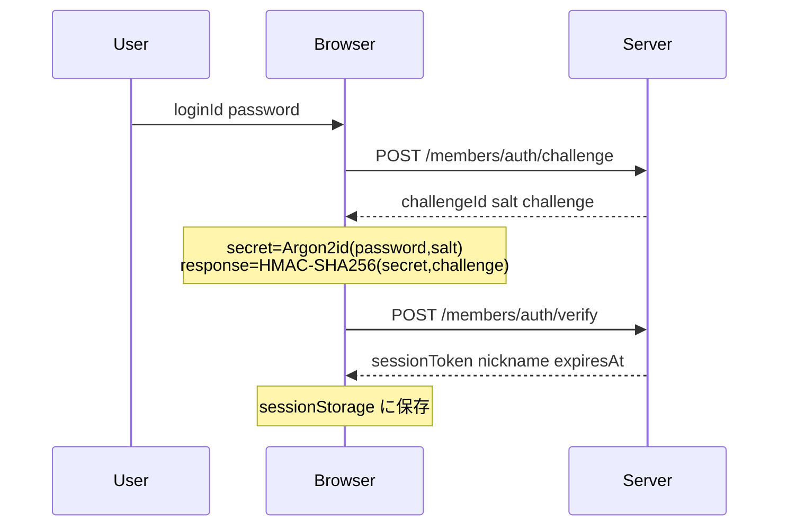
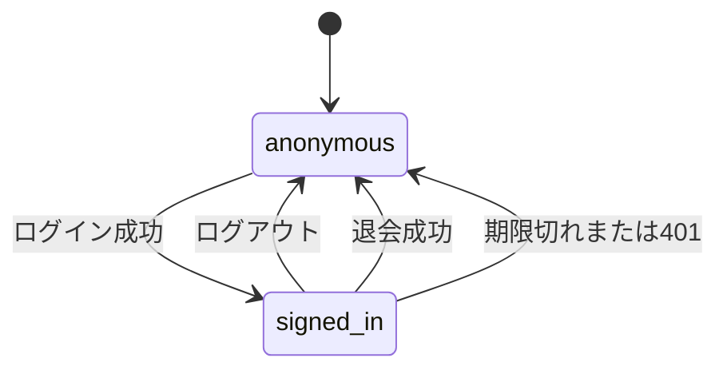

# 外部設計書: 会員フロント

| 項目 | 値 |
| --- | --- |
| 文書ID | `EDS-MEM-3` |
| 機能 | `MEM`（会員フロント） |
| 版 | `0.1` |
| 状態 | `approved` |
| 関連文書 | API 正本: [EDS-MEM-1](./EDS-MEM-1.md) / OpenAPI: `backend/openapi/openapi.yaml` / アーキテクチャ: [frontend-architecture.md](../frontend-architecture.md) / UT: [UT-MEM-3](../ut/plans/UT-MEM-3.md)（approved） / IT: （必要時） |

---

## 1. 目的・スコープ

### 目的

利用者がブラウザから会員登録・チャレンジレスポンス認証・退会を行える、必要最低限のフロント画面を提供する。API 契約は [EDS-MEM-1](./EDS-MEM-1.md) を正とし、本設計は画面・クライアント側の計算とセッション保持のみを定める。

### In Scope

- 登録画面（loginId / password / nickname）
- ログイン画面（challenge → クライアント KDF/HMAC → verify）
- 会員ホーム（ニックネーム表示・ログアウト・退会）
- ブラウザからの backend 直接呼び出し（CORS）
- セッション情報の `sessionStorage` 保持

### Out of Scope

- パスワード再設定・メール確認・OAuth
- セッション一覧・強制ログアウト・リフレッシュトークン
- BFF / Next.js Route Handler 経由の API プロキシ
- デザインシステム・カード群・ダッシュボード化・PWA
- レート制限 UI・アカウントロック UI
- 既存トップ（しろかぎ PoC）の改修（リンク追加以外は必須としない）
- backend / OpenAPI / EDS-MEM-1 の改訂

---

## 2. 用語

| 用語 | 意味 |
| --- | --- |
| API 正本 | [EDS-MEM-1](./EDS-MEM-1.md) および OpenAPI。HTTP 契約・制約・ステータスの正 |
| クライアントセッション | ログイン成功後にブラウザが保持する `sessionToken` / `nickname` / `expiresAt` |
| 汎用エラー文言 | 理由を区別しない短いメッセージ。API の列挙防止方針を UI でも守る |

用語「ログインID」「秘密値」「挑戦」「応答」「セッション」「論理削除」は EDS-MEM-1 §2 に従う。

---

## 3. アクター／前提

| アクター | 説明 |
| --- | --- |
| 未認証利用者 | 登録・ログイン画面を使える。会員ホームは使えない |
| 認証済み会員 | 有効なクライアントセッションを持ち、会員ホーム・退会ができる |

### 前提

- 通信は本番で HTTPS。ローカルは frontend → backend（例: `http://localhost:8080`）
- ブラウザが `API_BASE_URL` / `NEXT_PUBLIC_API_BASE_URL`（未設定時は `http://localhost:8080`）へ直接 fetch する
- クライアントは EDS-MEM-1 付録 A と同一の Argon2id パラメータで秘密値を導出し、HMAC-SHA256 で応答を計算できる
- 入力制約（長さ・文字種）は EDS-MEM-1 §6 を正とする。画面はクライアント側でも同制約を案内してよいが、最終判定は API

---

## 4. 機能一覧

| 機能ID | 名称 | 概要 |
| --- | --- | --- |
| F-01 | 会員登録画面 | 入力を受け取り `POST /members` を呼び、成功時はログイン画面へ遷移する |
| F-02 | ログイン画面 | 挑戦発行・応答計算・検証を行い、成功時にクライアントセッションを保存して会員ホームへ遷移する |
| F-03 | 会員ホーム | ニックネームを表示し、ログアウトと退会を提供する |
| F-04 | ログアウト | クライアントセッションを破棄し、ログイン画面へ遷移する（サーバ API は呼ばない） |
| F-05 | 退会 | 確認後に `DELETE /members/me` を呼び、成功時にクライアントセッションを破棄する |

---

## 5. 画面／API 契約

既存トップ `/`（しろかぎ PoC）は残す。会員画面は次のルートとする。

| 画面ID | ルート | 機能ID | 対応 API（EDS-MEM-1） |
| --- | --- | --- | --- |
| S-01 | `/members/register` | F-01 | `POST /members` |
| S-02 | `/members/login` | F-02 | `POST /members/auth/challenge` → `POST /members/auth/verify` |
| S-03 | `/members/me` | F-03 / F-04 / F-05 | `DELETE /members/me`（退会時） |

UI はフォームと状態表示のみ。装飾用カード・統計・複数セクションは置かない。

### 5.1 会員登録（S-01）

| 項目 | 値 |
| --- | --- |
| 機能ID | F-01 |
| 画面 | `/members/register` |
| Method / Path | `POST /members` |
| 認証 | 不要 |

**画面要素（最低限）**

| 要素 | 種別 | 必須 |
| --- | --- | --- |
| ログインID | テキスト入力 | はい |
| パスワード | パスワード入力 | はい |
| ニックネーム | テキスト入力 | はい |
| 登録 | 送信ボタン | — |
| エラー表示 | テキスト | 失敗時 |
| ログインへのリンク | リンク | — |

**リクエスト**（EDS-MEM-1 §5.1 と同形）

| 項目 | 型 | 必須 |
| --- | --- | --- |
| `loginId` | string | はい |
| `password` | string | はい |
| `nickname` | string | はい |

登録時のみ平文パスワードをペイロードに含める（EDS-MEM-1 §7）。

**成功時**

- HTTP 201 を受けたらクライアントセッションは作らず、`/members/login` へ遷移する
- 成功トースト等は必須としない

**失敗時の画面表示**

| HTTP | 画面文言（固定） |
| --- | --- |
| 400 / 409 / その他失敗 | `登録できませんでした。` |

項目名の列挙・重複対象の区別・レスポンス本文のエコーはしない。

---

### 5.2 ログイン（S-02）

| 項目 | 値 |
| --- | --- |
| 機能ID | F-02 |
| 画面 | `/members/login` |
| Method / Path | `POST /members/auth/challenge` →（クライアント計算）→ `POST /members/auth/verify` |
| 認証 | 不要（verify 自体が認証） |

**画面要素（最低限）**

| 要素 | 種別 | 必須 |
| --- | --- | --- |
| ログインID | テキスト入力 | はい |
| パスワード | パスワード入力 | はい |
| ログイン | 送信ボタン | — |
| エラー表示 | テキスト | 失敗時 |
| 登録へのリンク | リンク | — |

**クライアント手順**

1. `POST /members/auth/challenge` に `{ "loginId" }` を送る
2. 応答の `salt` / `challenge`（Base64）と入力パスワードから  
   `secret = Argon2id(password, salt)`（EDS-MEM-1 付録 A）  
   `response = Base64(HMAC-SHA256(secret, challengeBytes))`
3. `POST /members/auth/verify` に `{ "challengeId", "response" }` を送る
4. 成功時、レスポンスの `sessionToken` / `nickname` / `expiresAt` を `sessionStorage` に保存し、`/members/me` へ遷移する

ログインのリクエストに平文パスワードを含めない。

**失敗時の画面表示**

| 状況 | 画面文言（固定） |
| --- | --- |
| challenge / verify の 400・401・その他失敗、計算失敗 | `ログインできませんでした。` |

未登録・パスワード不一致・期限切れ等を UI で区別しない。

---

### 5.3 会員ホーム（S-03）

| 項目 | 値 |
| --- | --- |
| 機能ID | F-03 / F-04 / F-05 |
| 画面 | `/members/me` |
| 認証 | クライアントセッション必須 |

**入場条件**

- `sessionStorage` に有効な `sessionToken` があること
- 無い、または `expiresAt` が過去の場合はセッションを破棄して `/members/login` へ遷移する

**画面要素（最低限）**

| 要素 | 種別 |
| --- | --- |
| ニックネーム表示 | テキスト（`sessionStorage` の値） |
| ログアウト | ボタン |
| 退会 | ボタン |
| エラー表示 | テキスト（退会失敗時） |

**ログアウト（F-04）**

- サーバ API は呼ばない
- `sessionStorage` のクライアントセッションを削除し、`/members/login` へ遷移する

**退会（F-05）**

| 項目 | 値 |
| --- | --- |
| Method / Path | `DELETE /members/me` |
| 認証 | `Authorization: Bearer <sessionToken>` |
| 確認 | ブラウザの確認ダイアログを1回（文言例: `退会しますか？この操作は取り消せません。`） |

成功（204）後はクライアントセッションを破棄し、`/members/login` へ遷移する。

| HTTP | 画面文言（固定） |
| --- | --- |
| 401 / 404 / その他失敗 | `退会できませんでした。` |

401 の場合はセッションを破棄して `/members/login` へ誘導してよい。

---

## 6. データ項目と制約

入力項目の制約は EDS-MEM-1 §6 を正とする。画面側の案内用に同じルールを再掲する。

| 項目 | 制約 |
| --- | --- |
| ログインID | 半角英数字 `[A-Za-z0-9]`。長さ 8〜15 |
| パスワード | 半角。長さ 8〜15。英字・数字・許可記号をそれぞれ1文字以上。許可記号は EDS-MEM-1 §6 |
| ニックネーム | 1〜50（ルーン相当）。前後空白のみは不可 |

### クライアントセッション（sessionStorage）

| キー（論理名） | 内容 |
| --- | --- |
| `sessionToken` | Bearer 用トークン |
| `nickname` | 表示用 |
| `expiresAt` | RFC3339。期限切れなら未認証扱い |

永続キー名の実装詳細は実装時に固定し、本 EDS の論理名と対応づける。`localStorage` は使わない。Cookie への格納もしない。

### 論理削除・マスク

マスクの不可逆性・サーバ側の扱いは EDS-MEM-1 §6 に従う。フロントは退会成功後にクライアントセッションを破棄するのみ。

---

## 7. 認証方式

**方式名:** EDS-MEM-1 §7 と同じ（ソルト付き秘密値に対する HMAC チャレンジレスポンス）。フロントがクライアント側の計算を担う。

| ステップ | 送信元 | 内容 | 失敗時 |
| --- | --- | --- | --- |
| 1 | Browser | `loginId` で挑戦要求 | 画面は汎用ログイン失敗 |
| 2 | Server | `challengeId` / `salt` / `challenge` | （EDS-MEM-1） |
| 3 | Browser | Argon2id + HMAC-SHA256（付録 A 同一） | 画面は汎用ログイン失敗 |
| 4 | Server | 検証・セッション発行 | 画面は汎用ログイン失敗 |
| 5 | Browser | `sessionStorage` 保存 → `/members/me` | — |

KDF パラメータは EDS-MEM-1 付録 A を下回らない。ライブラリ選定（例: WebAssembly 実装）は実装時とし、本設計は計算契約のみを正とする。

---

## 8. 状態遷移

| 状態 | 意味 |
| --- | --- |
| anonymous | クライアントセッションなし。S-01 / S-02 を利用可 |
| signed_in | 有効なクライアントセッションあり。S-03 を利用可 |

会員のサーバ側 `active` / `deleted` は EDS-MEM-1 §8。フロントはセッション有無で画面を切り替える。

---

## 9. エラー方針

| 方針 | 内容 |
| --- | --- |
| クライアント向け文言 | §5 の固定短文のみ。スタック・HTTP 本文・内部例外を出さない |
| 登録 400 / 409 | UI でも区別しない |
| 認証失敗 | challenge / verify / 計算失敗を同じ文言に寄せる |
| ネットワーク失敗 | 各操作の汎用失敗文言に寄せる |
| コンソール／ログ | 平文パスワード・秘密値・response・sessionToken 全文を残さない |

---

## 10. 非機能・セキュリティ（外部から見える約束）

| 項目 | 約束 |
| --- | --- |
| パスワード送信 | 登録時のみ。ログイン時は送らない |
| クライアント KDF | EDS-MEM-1 付録 A 以上。弱めない |
| セッション保管 | `sessionStorage` のみ。XSS に弱い点は実験場の既知前提とし、httpOnly Cookie 化は本版の対象外 |
| 通信 | 本番は HTTPS。Bearer トークン |
| CORS | frontend オリジンから backend を直接呼ぶ（既存方針） |
| UI 規模 | 必要最低限の入力・ボタン・1行エラー。過剰コンポーネントを置かない |
| レート制限 UI | Out of Scope |

---

## 11. 関連テスト（トレーサビリティ）

| 本設計の対象 | UT | IT |
| --- | --- | --- |
| 全体 | [UT-MEM-3](../ut/plans/UT-MEM-3.md) | 必要時に採番 |
| F-01 登録クライアント | V-* / C-01〜C-02 / E-01 | — |
| F-02 クライアント認証計算 | A-* / C-03〜C-05 / C-08 / E-02 | — |
| F-03〜F-05 セッション／退会呼び出し | S-* / C-06〜C-07 / E-03 | — |

画面 E2E は初期必須としない。入力制約・KDF/HMAC・API ヘルパを UT の主対象とする。backend 単体の契約検証は `UT-MEM-1` / `IT-MEM-1` に任せ、FE 側に焼かない。
