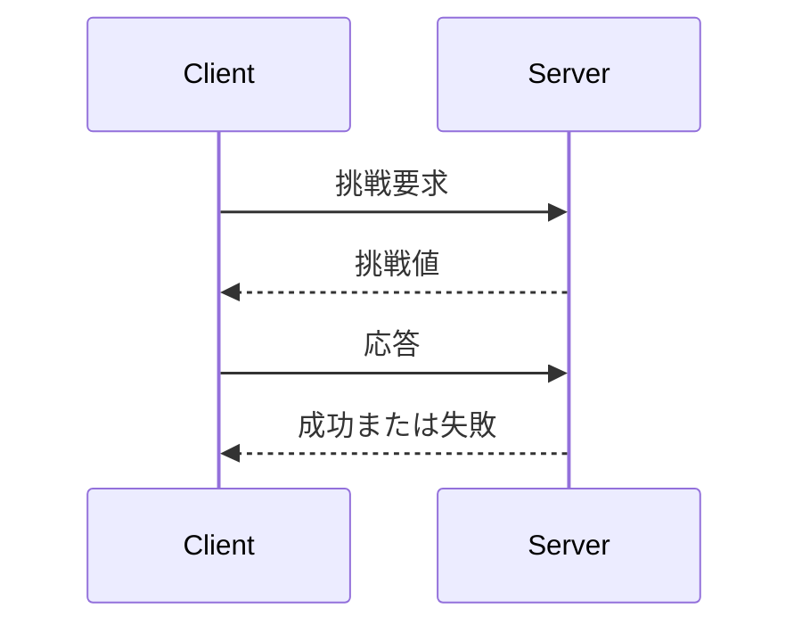
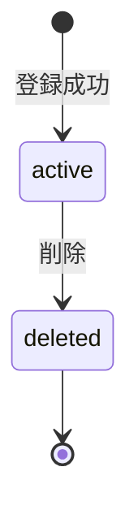

# 外部設計書: \<機能名\>

| 項目 | 値 |
| --- | --- |
| 文書ID | `EDS-<機能>-NNN` |
| 機能 | \<機能コード・名称\> |
| 版 | `0.1` |
| 状態 | `draft` / `approved` |
| 関連文書 | UT: `docs/ut/plans/UT-…` / IT: `docs/it/plans/IT-…` / アーキテクチャ: [go-architecture.md](../go-architecture.md) |

---

## 1. 目的・スコープ

### 目的

（この機能が利用者・他システムに提供する価値を1〜3文）

### In Scope

- （例: 会員登録、チャレンジレスポンス認証、論理削除）

### Out of Scope

- （例: パスワード再設定、OAuth、管理画面）

---

## 2. 用語

| 用語 | 意味 |
| --- | --- |
|  |  |

---

## 3. アクター／前提

| アクター | 説明 |
| --- | --- |
| 未認証利用者 |  |
| 認証済み会員 |  |

### 前提

- （例: HTTPS、クライアントがチャレンジレスポンスを計算できる）

---

## 4. 機能一覧

| 機能ID | 名称 | 概要 |
| --- | --- | --- |
| F-01 |  |  |
| F-02 |  |  |
| F-03 |  |  |

---

## 5. 画面／API 契約

エンドポイント単位で表を書く。画面がある場合は画面IDと対応 API を併記する。

### 5.x \<操作名\>

| 項目 | 値 |
| --- | --- |
| 機能ID | F-0x |
| Method / Path |  |
| 認証 | 不要 / 要 |

**リクエスト**

| 項目 | 型 | 必須 | 制約 |
| --- | --- | --- | --- |
|  |  |  |  |

**レスポンス（成功）**

| 項目 | 型 | 説明 |
| --- | --- | --- |
|  |  |  |

**ステータス**

| 状況 | HTTP | 本文の要点 |
| --- | --- | --- |
| 成功 |  |  |
| 入力不正 |  |  |
| 競合・重複 |  |  |
| 認証失敗 |  |  |

---

## 6. データ項目と制約

| 項目 | 制約 | 一意 | 備考 |
| --- | --- | --- | --- |
| ID |  |  |  |
| パスワード |  | — | 保存形態（ハッシュ等）は「非機能・セキュリティ」に書く |
| ニックネーム |  |  |  |
| 削除フラグ等 |  | — | 論理削除時の扱い |

### 論理削除・マスク

| 項目 | 削除時の扱い |
| --- | --- |
| ID | （例: マスクし復元不可） |
| パスワード |  |
| ニックネーム |  |
| 行自体 | 物理削除しない |

---

## 7. 認証方式

方式名と、クライアント／サーバ間のシーケンスを書く。実装アルゴリズムの細部より、**交換する値と失敗時の見え方**を正とする。

| ステップ | 送信元 | 内容 | 失敗時 |
| --- | --- | --- | --- |
| 1 | Client |  |  |
| 2 | Server |  |  |
| 3 | Client |  |  |
| 4 | Server |  |  |

---

## 8. 状態遷移

| 状態 | 意味 |
| --- | --- |
| active | 有効な会員 |
| deleted | 論理削除済み（マスク済み・認証不可） |

---

## 9. エラー方針

| 方針 | 内容 |
| --- | --- |
| クライアント向け文言 | （例: 汎用メッセージにし、内部詳細を出さない） |
| 認証失敗の区別 | （例: ID 有無を漏らさない） |
| ログ | （例: 平文パスワード・挑戦の生値を残さない） |

---

## 10. 非機能・セキュリティ（外部から見える約束）

| 項目 | 約束 |
| --- | --- |
| パスワード保存 |  |
| マスクの不可逆性 |  |
| 通信 |  |
| レート制限等 | （初期は Out of Scope ならその旨） |

---

## 11. 関連テスト（トレーサビリティ）

| 本設計の対象 | UT | IT |
| --- | --- | --- |
| 全体 | `UT-<機能>-NNN` | `IT-<機能>-NNN` |
| （節・機能ID） | （ケースID） | （シナリオID） |
